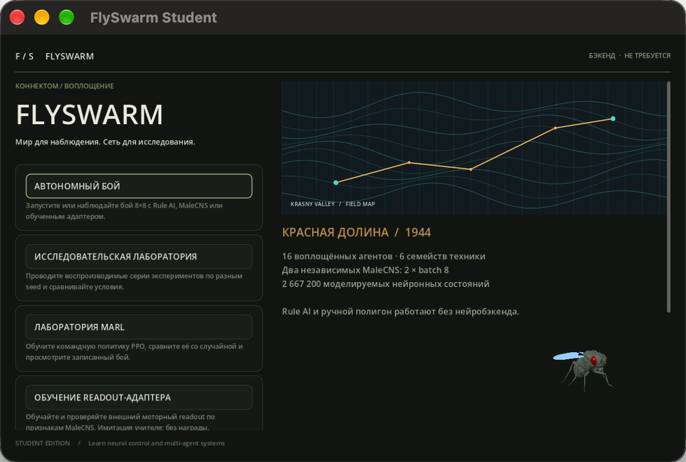
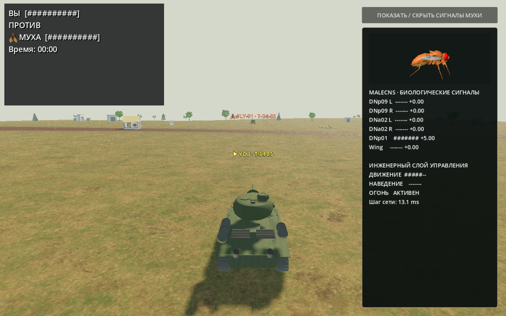

# FlySwarm

FlySwarm — исследовательская и учебная среда для многoагентной симуляции боя,
моделей нейронного коннектома Drosophila MaleCNS и мультиагентного обучения с
подкреплением. Приложение объединяет симуляцию на Godot 4 и Python-бэкенд.

Доступны два варианта приложения:

| Вариант | Для кого | Основные возможности |
|---|---|---|
| **FlySwarm** | Исследования и демонстрации | Open Day, бой 8×8, полигон, записи боёв, исследовательские эксперименты, MARL, Readout и MaleCNS Combat Training |
| **FlySwarm Student** | Практические занятия | MARL Laboratory с редактором Python, терминалом и примерами `agent.py` / `reward.py`, PPO, оценкой и сравнением стратегий; Readout training |

Student Edition скрывает Open Day и MaleCNS Combat Training. В обеих версиях
остаются научные вычисления, на которых построены доступные режимы.

## Скриншоты

Актуальный экран FlySwarm Student, снятый из запущенного приложения 22 октября
2026 года:



Экран Open Day полной версии:


Бой с живой панелью сигналов MaleCNS:



## Скачать

Beta 1 включает само приложение, Python backend, необходимые библиотеки, модели
техники и дрозофилы, а также `brain.npz` и `weights.npz`. Для этих сборок не
нужно отдельно устанавливать Python или искать файлы мозга.

| Приложение | macOS Apple Silicon | Windows x64 |
|---|---|---|
| FlySwarm, полная версия | [DMG и ZIP — Beta 1](https://github.com/seruyvodoley/flyswarm-connectome/releases/tag/v1.0.0-beta.1) | Windows-версия Open Day не публикуется |
| FlySwarm Student | [DMG и ZIP — Student Beta 1](https://github.com/seruyvodoley/flyswarm-connectome/releases/tag/v1.0.0-student-beta.1-macos) | [Установщик и portable ZIP — Student Beta 1](https://github.com/seruyvodoley/flyswarm-connectome/releases/tag/v1.0.0-student-beta.1-windows) |

Рядом с пакетами опубликован `SHA256SUMS.txt` для проверки загрузки.
macOS-приложение подписано ad-hoc и не нотариализовано; при первом запуске
Gatekeeper может попросить разрешить открытие приложения.

## MARL Laboratory

Студент проходит полный цикл эксперимента в одной лаборатории:

1. Настраивает сценарий, число шагов и seed.
2. Редактирует и проверяет собственные Python-стратегию и награду.
3. Запускает Random baseline или PPO, следит за прогрессом и при необходимости останавливает запуск.
4. Независимо оценивает и сравнивает стратегии на общих seed.
5. Просматривает историю и реплей, сохраняет результаты практической работы.

Шаблоны в редакторе — рабочие примеры кода. `act(observation, context=None)`
возвращает массив из шести управляющих значений; функция
`calculate_reward(components)` возвращает одно числовое вознаграждение за шаг.
Редактор поддерживает подсветку Python, нумерацию строк, поиск, горячие клавиши,
переключение `agent.py` / `reward.py` и отдельную консоль для команд в проектной
среде.

MARL Laboratory использует аналитическую PettingZoo-среду. Её результаты и
метрики не являются результатами боевой симуляции Godot или оценкой MaleCNS.
Награда обучения PPO и независимая оценка эффективности показываются отдельно.

Подробности и материалы преподавателя: [практикум](docs/practicum_marl.md),
[руководство преподавателя](docs/practicum_marl_teacher.md),
[Python API](docs/marl_python_api.md).

## Запуск из исходников

Требуются Godot 4.7.2 и Python 3.11. Установленное приложение из раздела выше
не требует ручной настройки backend.

```sh
./run.sh
```

В исходниках `Rule AI` и полигон доступны без MaleCNS dataset. Для Open Day и
боёв с настоящим FlyBrain настройте совместимый dataset в разделе параметров
MaleCNS. macOS-релизы Beta 1 включают проверенные `brain.npz` и `weights.npz`.

Основные команды MARL CLI:

```sh
PYTHONPATH=src .venv/bin/python -m flyswarm.marl.cli baseline --episodes 3
PYTHONPATH=src .venv/bin/python -m flyswarm.marl.cli train --steps 10000
PYTHONPATH=src .venv/bin/python -m flyswarm.marl.cli compare <checkpoint.zip> --episodes 5
```

## Архитектура и ограничения

В полном бою Godot формирует наблюдения, Python выполняет сенсорную обработку
и вызывает MaleCNS, а нисходящие сигналы проходят через внешний моторный
адаптер. Экземпляры MaleCNS команд независимы; в исследовательском режиме это
два `FlyBrain(batch=8)`. PPO в MARL Laboratory обучает отдельную внешнюю
политику и не меняет веса или связи коннектома.

Визуализация мухи и танков предназначена для приложения и не является
доказательством биологической или исторической точности. Полная историческая
валидация всех моделей техники не выполнена. Windows Student сборка проходит
проверки и smoke-тест в CI; GUI и MaleCNS вручную на физическом Windows-компьютере
не проверялись.

Исследовательские результаты сохраняются отдельно от приложения и не
перезаписывают предыдущие запуски. Каталог `results/` исключён из Git;
описание файлов и метрик находится в [журнале экспериментов](docs/experiment_log.md).

## Проверки

```sh
./tools/run run-tests
./run.sh --headless --script res://scripts/app/validation.gd
```

Инструкции по сборке: [macOS](docs/macos_packaging.md) ·
[Windows](docs/windows_packaging.md). Источники и лицензии визуальных моделей:
[`ASSET_SOURCES.md`](frontend/godot/assets/environment/ASSET_SOURCES.md).
