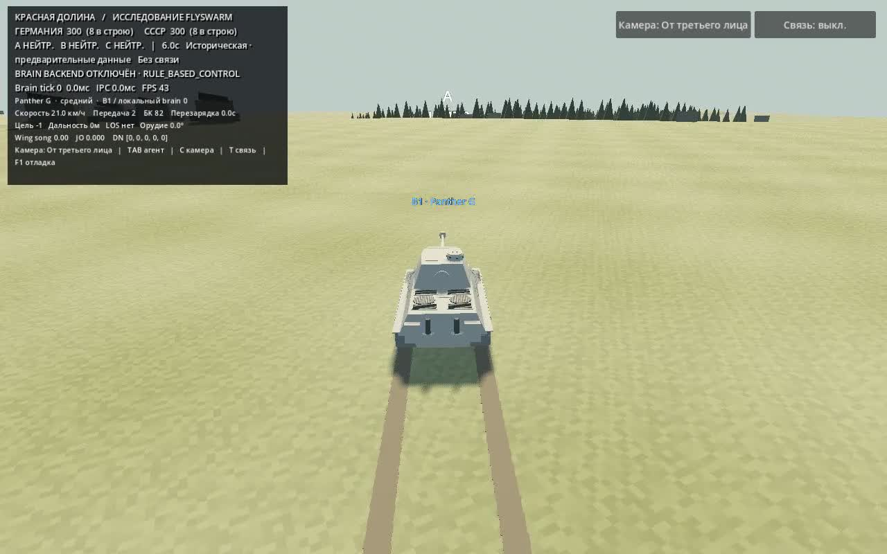
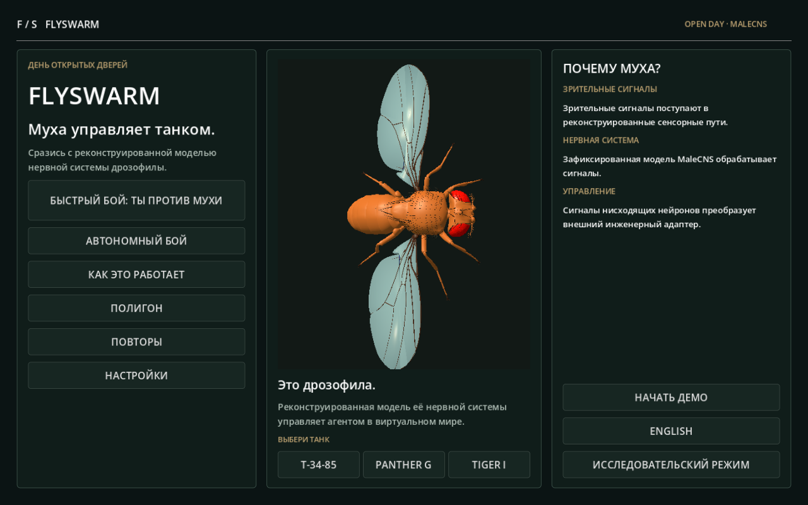

# FlySwarm — коннектом в танковой среде

Исследовательская симуляция боя **8 × 8**: Godot моделирует мир и технику,
а Python связывает наблюдения агентов с реконструированным коннектомом
**Drosophila MaleCNS**. Можно наблюдать автономный бой, управлять танком
на полигоне и сравнивать условия эксперимента.

## Скринкаст интерфейса

[](docs/media/interface-demo.mp4)

**[Смотреть / скачать MP4](docs/media/interface-demo.mp4)** · 35 секунд ·
1280 × 800 · без звука. Запись реального интерфейса: главное меню, настройка
боя, камеры, пауза, ручной полигон, исследовательская лаборатория, обучение,
настройки и повторы. В записи используется Rule AI; она не изображает
запуск нейробэкенда. Переходы автоматизированы для воспроизводимой записи.
GitHub может предложить скачать MP4 вместо встроенного воспроизведения.

### Open Day Demo



Отдельный режим «Муха управляет танком» показывает 3D-модель дрозофилы,
короткую схему `сенсорные сигналы → MaleCNS → внешний моторный адаптер` и
игровой бой 1 × 1 на компактной арене. Гость выбирает T-34-85, Panther G или
Tiger I; машина едет вперёд автоматически. Движение мыши независимо наводит
башню и задаёт УВН, средняя кнопка с перетаскиванием поворачивает корпус,
ПКМ стреляет. Кнопкой камеры или колёсиком можно выбрать вид наводчика; в нём
ЛКМ включает оптическое увеличение и прицельную сетку. Панель боя раздельно
показывает живые выходы MaleCNS и команды инженерного адаптера.

В демонстрации работает один настоящий `FlyBrain(batch=1)` для противника.
Полный исследовательский режим сохранён как два независимых
`FlyBrain(batch=8)`. Визуальные модели, PBR-карты, лицензии и источники
перечислены в [`ASSET_SOURCES.md`](frontend/godot/assets/environment/ASSET_SOURCES.md).
Для техники применяются индивидуальные процедурные ливреи поверх исходных
surface-материалов; просмотрщик в меню загружает выбранный GLB без физики.
Скриншоты трёх машин в просмотрщике и бою, четырёх ракурсов мухи и экранов
результата лежат в [`artifacts/open_day_final_validation/`](artifacts/open_day_final_validation/).
Кадры главного экрана, объясняющей схемы, живого боя с MaleCNS и результата
лежат в [`artifacts/open_day_graphics/`](artifacts/open_day_graphics/).

**[Скринкаст Open Day Demo](docs/media/open-day-demo.mp4)** · 1280 × 720 · без звука.

## Что работает

| Возможность | Описание |
|---|---|
| Исторический бой | 16 машин, две команды, точки A/B/C, билеты и итоговая статистика |
| Open Day Demo | Отдельный бой посетителя с одним настоящим MaleCNS-противником; арена, PBR-земля, объясняющая схема и живая панель сигналов |
| Контроллеры | Rule AI, MaleCNS, фиксированный обученный моторный адаптер для каждой команды |
| Камеры | Обзор поля боя, от третьего лица, прицел и свободная камера |
| Ручной полигон | Выбор машины и цели, дистанции 100–1500 м, углы цели, движение и стрельба |
| Физика | Движение, конечная скорость снаряда, приближённая броня и повреждения модулей |
| Гусеницы | Видимые следы с приближённым влиянием давления, поверхности и проскальзывания |
| Нейронная связь | No Audio / Team Audio / All Audio; панель сигналов и линии между агентами |
| Research Lab | Сравнение условий связи, физики, смены сторон и переноса политик; отмена задания |
| Обучение | Сбор примеров, ridge-адаптер, сохранение и проверка на отдельном seed |
| Повторы | Запись состояний мира и телеметрии, воспроизведение без MaleCNS |
| MARL Laboratory | Random baseline, обучение Stable-Baselines3 PPO, независимая оценка, paired comparison и replay на настоящих моделях |
| MARL Python CLI | Воспроизводимые PettingZoo-эксперименты без Godot, MaleCNS или dataset; CSV, JSON, график, checkpoint и траектории |
| Интерфейс | RU/EN, сохранение языка и настроек, пауза, возврат в меню, управление бэкендом |

Расчёт пробития, последствия попаданий и границы исторической точности
описаны в [модели брони и повреждений](docs/armour_damage_model.md).

MARL-практическая использует отдельную аналитическую PettingZoo-среду. В ней
Python задаёт состояние и награду, а Godot Viewer воспроизводит сохранённую
траекторию; обычная физика боя не пересчитывает эти результаты. Для запусков
из терминала:

```sh
PYTHONPATH=src .venv/bin/python -m flyswarm.marl.cli baseline --episodes 3
PYTHONPATH=src .venv/bin/python -m flyswarm.marl.cli train --steps 10000
PYTHONPATH=src .venv/bin/python -m flyswarm.marl.cli compare results/raw/marl/<training-id>/checkpoint/ppo_team.zip --episodes 5
```

В Windows PowerShell сначала задайте `$env:PYTHONPATH="src"` и используйте
`.venv\Scripts\python.exe`. Команды CLI одинаковы в Windows, Linux и macOS.
Windows x64 export, installer и Python backend проверяются в GitHub Actions;
графический интерфейс и MaleCNS на физической Windows-машине пока не проверены.
Сборка описана в [`docs/windows_packaging.md`](docs/windows_packaging.md).
Подробная методика для студентов и преподавателя:
[`docs/practicum_marl.md`](docs/practicum_marl.md) и
[`docs/practicum_marl_teacher.md`](docs/practicum_marl_teacher.md).

Примеры записанного боя: [Random](artifacts/marl/random-battle.png) ·
[обученная PPO-политика](artifacts/marl/trained-ppo-battle.png). Аналитические
маркеры показывают зарегистрированные события и не задают точную точку попадания.

Техника: **Panther G, Tiger I, Jagdpanther, T-34-85, IS-2, SU-100, Tiger**.


## Быстрый старт

Интерактивно проверенная платформа: macOS Apple Silicon. Windows x64 получает
автоматическую сборку и headless smoke-тест в CI; это не подтверждает ручную
работу графического интерфейса. Для запуска из исходников нужен Godot 4.7.2.

```sh
./run.sh
```

Откроется главное меню. Rule AI и полигон доступны без загрузки MaleCNS.
Путь к другому Godot можно передать через `GODOT` — см. `run.sh`.

Для публичной демонстрации «Муха управляет танком» используйте отдельный
режим Open Day. Он открывает русскоязычное меню, короткий бой 1 × 1 и живую
панель нисходящих нейронов реального MaleCNS:

```sh
./tools/run run-open-day
```

В демо машина сама движется вперёд. Двигайте мышь, чтобы поворачивать башню и
поднимать или опускать орудие. Перетаскивайте средней кнопкой, чтобы отдельно
поворачивать корпус. ПКМ стреляет; выберите вид наводчика кнопкой камеры или
колёсиком, затем нажмите ЛКМ для оптического режима с прицельной сеткой. Для
боя нужен локальный MaleCNS dataset: демо не подменяет нейронного соперника
Rule AI.

Для нейронного режима дополнительно подготовьте Python 3.11:

```sh
python3.11 -m venv .venv
.venv/bin/python -m pip install -r requirements.txt
```

MaleCNS dataset устанавливается отдельно в расположение, ожидаемое FlyBrain
(в проверенном окружении `/Users/serg/fly-data`). Dataset и `.venv` не входят
в Git. При отсутствии зависимостей приложение предлагает повторить запуск
или выбрать Rule AI. [Подробности запуска](docs/application.md).

## Управление

| Клавиша | Действие |
|---|---|
| `C` / кнопка камеры | Переключить камеру |
| Колесо, `WASD` в обзоре | Масштаб и перемещение по карте |
| `Tab` | Следующий агент |
| `T` / кнопка связи | Выкл. → красные → синие → все |
| `Esc` | Пауза / меню |
| Движение мыши в Open Day | Башня по горизонтали, УВН по вертикали |
| Перетаскивание средней кнопкой в Open Day | Независимый поворот корпуса |
| ЛКМ / ПКМ в виде наводчика | Оптика / выстрел |
| Колесо / кнопка камеры | Переключение третьего лица и вида наводчика в Open Day |
| `W/S`, `A/D` на полигоне | Движение и поворот |
| `Q/E`, `R/F` | Башня и вертикальная наводка |
| Пробел / ЛКМ, движение с ПКМ | Выстрел, наведение |
| `F1` | Отладочный вид |

## Как устроен эксперимент

```text
Godot: мир → признаки наблюдения
                 ↓
Python: сенсорный кодировщик → два отдельных FlyBrain(batch=8)
                 ↓
нисходящие нейроны → моторный readout → действия в Godot
```

Каждая команда получает отдельный объект MaleCNS; это **2 × batch 8**,
а не один batch 16. В проверенном dataset — 2 667 200 нейронных состояний.
Коннектом фиксирован. Обучение меняет небольшой моторный readout, а не
связи MaleCNS. Нейронный сигнал крыльев предыдущего шага поступает через
среду к JO-A/JO-B; панель показывает численные вклады, не расшифрованную речь.

Это исследовательская модель, не доказательство биологического поведения.
Сенсорный ввод использует признаки вместо изображения сетчатки; ряд функций,
включая базовую стрельбу, задаётся правилами. Исторические размеры, броня и
физика содержат приближения. Полная историческая валидация моделей не пройдена.
Недоступные учебные задачи отключены; награда для ridge imitation не определена.
macOS-приложение подписывается ad-hoc без Developer ID и не нотариализовано;
при первом запуске Gatekeeper может потребовать ручное разрешение.

## Проверки и воспроизводимость

```sh
./tools/run run-tests
./run.sh --headless --script res://scripts/app/validation.gd
# Только при установленном реальном dataset:
./run.sh --headless --script res://scripts/app/validation.gd -- --real-brains
```

Seed, параметры сессии, метрики и повторы сохраняются в `results/raw/app/`
при запуске из исходников. Каждая записанная сессия создаёт ограниченные
`results.csv`, `per_agent.csv`, `actions.csv` и `summary.json`; action export
разделяет нейронный trace, decoder, objective/gunnery auxiliary, adapter и
финальное действие. Raw-вывод исключён из Git. Старые исследовательские
файлы сохранены; [журнал экспериментов](docs/experiment_log.md) и
[исторический контекст](docs/research_background.md).

## Структура проекта

```text
frontend/godot/   приложение, сцены, интерфейс, 3D-модели
src/flyswarm/     Python-бэкенд, сенсорика, readout, IPC
assets/models/   исходные Blender-модели
experiments/     исторические исследовательские эксперименты
archive/         сохранённые прототипы
data/            параметры техники, вооружения и сценариев
tests/           быстрые проверки без загрузки dataset
tools/           запуск, генерация моделей, проверки
docs/media/      скринкаст и его обложка
docs/            исследования, источники, валидация
```

[Архитектура приложения](docs/application.md) ·
[PettingZoo и MARL](docs/marl.md) ·
[Приближения](docs/known_approximations.md) ·
[Источники моделей](docs/references/pass03_audit.md) ·
[Подготовка macOS-сборки](docs/macos_packaging.md) ·
[Сборка Windows x64](docs/windows_packaging.md)
