# Open Day Beta 5: реализация и аппаратная проверка

Дата: 28 октября 2026. MacBook Pro, Apple M2, 8 ГБ RAM, macOS 27.0.1,
Godot 4.7.2, Metal Mobile. Во время аппаратных прогонов заданы
`OMP_NUM_THREADS=2` и `OPENBLAS_NUM_THREADS=2`, чтобы ограничить фоновую нагрузку библиотек.
Работа в существующем репозитории на рабочем столе:
RisingSail отсутствует в списке подключённых томов. Новых клонов/рабочих деревьев нет.
Реализация непосредственно в `main` по последнему указанию владельца;
ветка и релизы Student не меняются.

## Карта до и после

Одинаковый охват камеры 760 м, настоящий рендер Godot 1280×800.
Обзорные снимки показывают всю растительность без отсечения по дистанции.

| До: 420×420 м, 4 здания | После: 700×700 м, 10 зданий |
|---|---|
| 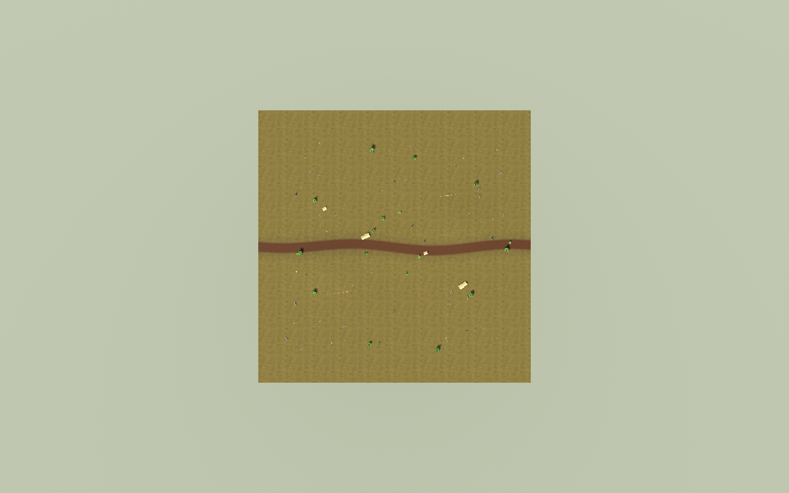 | 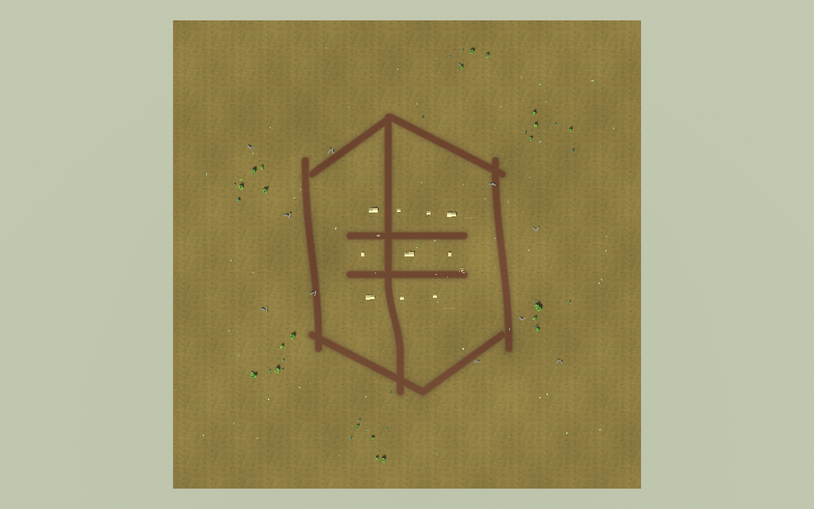 |

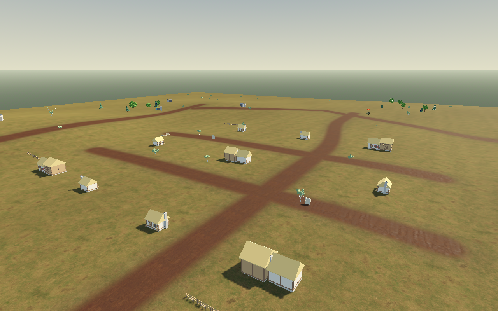
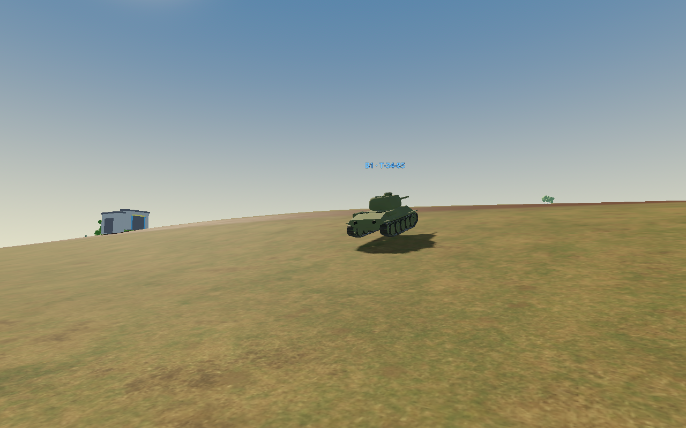
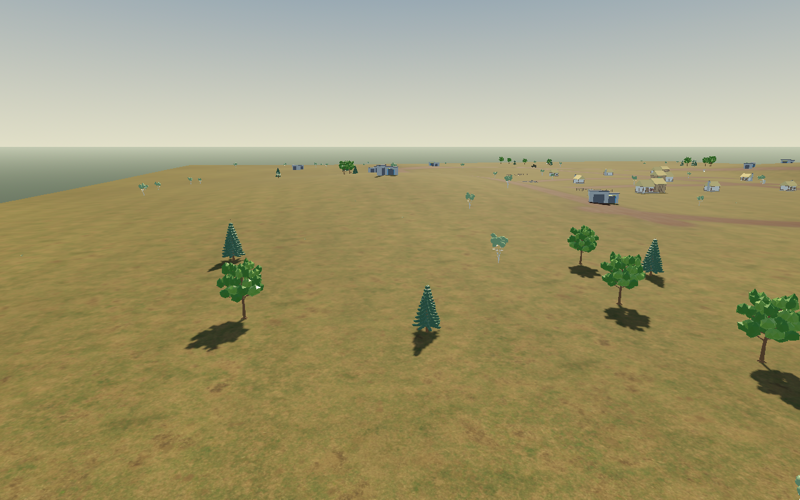
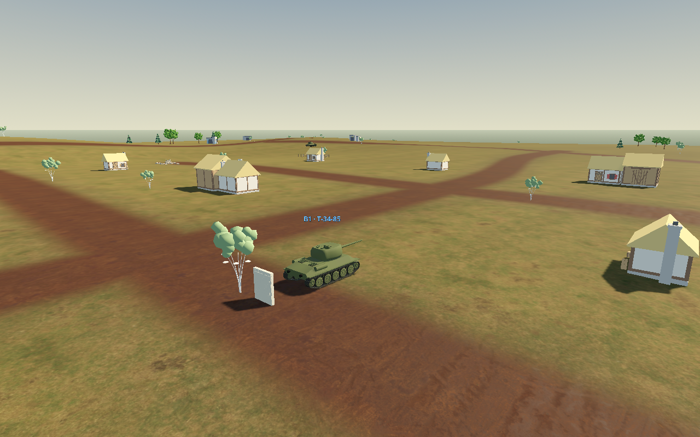
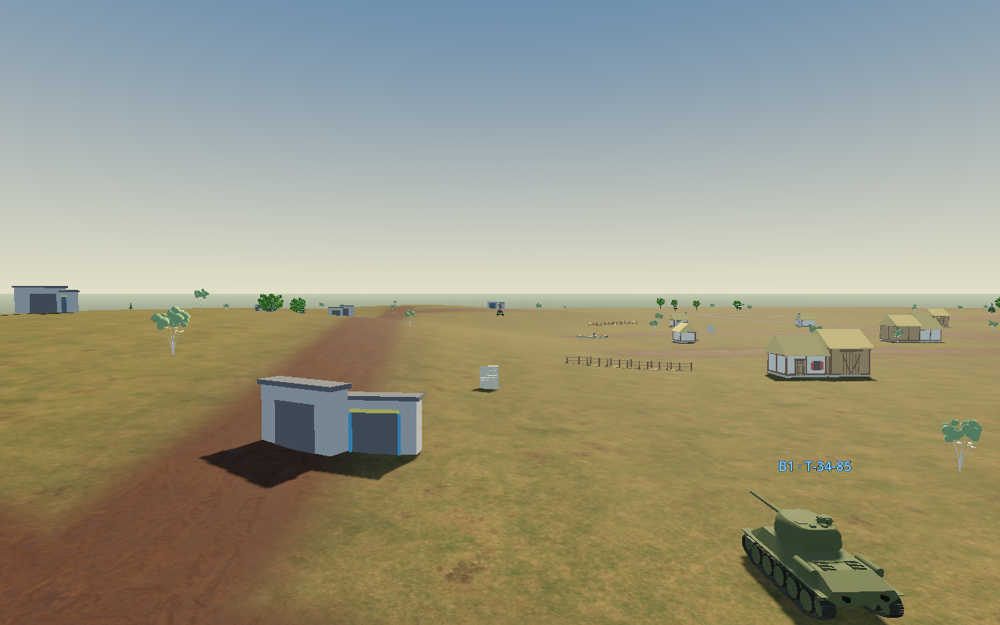
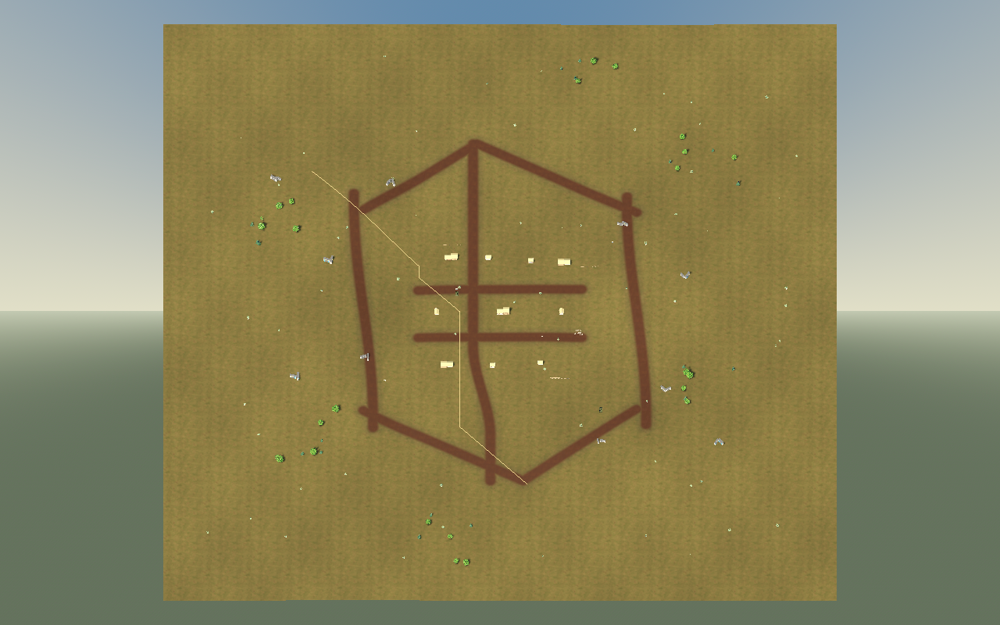
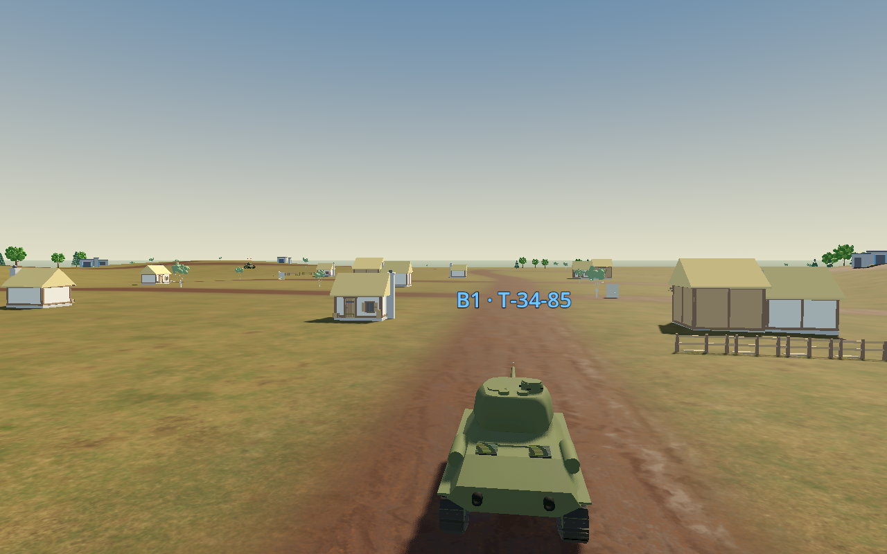

Масштаб исходных ресурсов сохранён: дом 13,4×7,0×6,8 м,
коттедж 6,22×5,36×5,08 м, деревья высотой примерно 6–10 м с вариацией.
Скриншоты сцен — поставленные геометрические ракурсы, не доказательство тактики;
поведение отдельно проверяется физическими траекториями и полными матчами.

## Геометрия и движение

Высоты −2,17…9,92 м; наибольший измеренный уклон 22,7%.
Три независимых маршрута проходят физическую проверку ширины корпуса.
[Все десять зданий](open-day-beta5-buildings.json) отдельно проверены: координаты,
ориентация, размещение внутри территории и настоящее твёрдое перекрытие луча над фундаментом.
Проверены свободные стартовые позиции восьми seed и перекрытие первоначальной
линии огня настоящей геометрией; десятисекундная завеса — дополнительное прикрытие.
Есть свободные сектора на 100, 180 и 240 м.

Все шесть реальных моделей физически прошли **каждый из трёх маршрутов**:
18 заездов, 0 застреваний. Ниже — западный маршрут;
[полные результаты всех коридоров](open-day-beta5-all-routes.json).

| Машина | Пройдено, м | Симуляционное время, с |
|---|---:|---:|
| t34_85 | 582.1 | 110.50 |
| is2_1944 | 576.8 | 176.44 |
| panther_g | 580.6 | 114.26 |
| tiger_i | 579.5 | 154.18 |
| jagdpanther | 582.3 | 127.40 |
| su100 | 580.6 | 115.66 |

Воспроизводимые сценарии проверяют торможение на 180 м, реальный отход от близкого
противника, маршрут вокруг здания, фланговое физическое движение, ограниченную засаду
при потере цели, поиск после неё, восстановление из неподвижности и выбор разных
достижимых позиций для разных seed. Шестимодельный огневой тест отдельно проверяет
баллистику и корпусное наведение безбашенных машин. [Данные геометрии](open-day-beta5-geometry.json).

## Контроллер и найденные ошибки

- Простая радиальная цель заменена кандидатными огневыми позициями и A*.
  Каждое соединение графа проверяется на ширину и реальную физическую геометрию;
  диагональное срезание стены, найденное первым тестом, устранено в самом графе.
- Выбор позиции учитывает защищённость корпуса, сектор орудия, дистанцию,
  стоимость маршрута, разворот и выходы. Предпочтительная дальность зависит от орудия
  и башни. Нет обязательной тяги от нейронного сигнала при удержании/торможении.
- Засада ограничена временем после потери контакта. Неподвижность при развороте
  и при выходе из удержания не вызывает ложное восстановление.
- После первых прогонов обнаружен откат на подъёмах: прежний предел плоского
  ускорения применялся до гравитации. В Open Day добавлена компенсация уклона,
  ограниченная реальной доступной мощностью и сцеплением. Научный путь расчёта
  сохранён. Дорожный грунт привязан к новым дорогам.
- Упреждение, ускорение цели, компенсация собственной скорости и наклона сохранены.
  Дополнительный луч от дула запрещает выстрел через непрозрачное укрытие.
- Камера сохраняет прежнее исправление интерполяции; дальняя граница и обзорный
  охват адаптированы к 700 м. Мышиное наведение достаёт до дальних участков.
- MaleCNS остаётся настоящим: 166 700 нейронов, один FlyBrain(batch=1), исходные
  файлы не меняются. Тактическая помощь — внешний игровой слой, не обучение мозга.

## Производительность

20 секунд после 4 секунд прогрева, одинаковая камера и координаты машин,
1280×800, тени включены, растительность 0,6, VSync. Сравниваются прежняя
и новая карта; исходники Beta 4 извлекаются из коммита 1ce6bda без второго клона.

| Показатель | Beta 4 | Beta 5 |
|---|---:|---:|
| FPS | 60.00 | 59.90 |
| Средний кадр, мс | 16.67 | 16.70 |
| p99 кадра, мс | 17.15 | 18.14 |
| Среднее число draw calls | 2194.26 | 324.26 |
| Создание сцены, мс | 2076.50 | 2555.42 |

FPS ограничен VSync: прирост FPS не заявляется. Вызовы отрисовки сократились
примерно на 85%, хотя площадь выросла в 2,78 раза. Создание сцены подорожало;
это не скрыто за утверждением «всё быстрее». Первый пробный замер 2880×1800
не используется для сравнения с 1280×800. [Исходные данные](open-day-beta5-render.json).

Подтверждённое узкое место — сотни объектов веток/листьев на дерево.
Объединение по 2–4 материалам и MultiMesh сокращают вызовы отрисовки.
Высоты/нормали рассчитываются по общей сетке; одинаковые коллизии зданий
переиспользуются. Отдельный выигрыш времени от этих двух кэшей не изолировался.
Граф строится один раз во время заставки; в проверке около 159 мс,
151 запрос маршрута суммарно около 4,7 мс. Оценка позиций выполняется раз в 1,2 с.

## Полные аппаратные матчи

Окончательный код: `a5c2820b24337c472d1a637d1a3caafe6fd9a291`.
Реальный FlyBrain(batch=1), 166 700 нейронов, проверенные исходные файлы MaleCNS.
Ни один матч не завершался принудительно: уничтожение противника или штатный лимит.
Использован программный ввод мыши; это не сравнение с умелым человеком и не оценка баланса.

| Seed | Машина | Время, с | Итог | Выстрелы / попадания мухи | Дальность её огня, м | Прямой прострел, с | Ответы MaleCNS |
|---|---|---:|---|---:|---:|---:|---:|
| 204 | t34_85 | 49.56 | fly | 7 / 6 | 186.3–353.3 | 18.0 | 2453 |
| 205 | panther_g | 69.66 | fly | 9 / 6 | 188.7–327.0 | 48.4 | 3460 |
| 206 | su100 | 90.18 | fly | 7 / 6 | 215.6–267.3 | 52.1 | 4471 |
| 207 | tiger_i | 97.26 | fly | 10 / 6 | 176.7–380.9 | 87.3 | 4840 |
| 208 | jagdpanther | 62.78 | fly | 7 / 6 | 238.3–344.3 | 42.9 | 2823 |

| Машина | Смены позиций | Попытки обхода | Застревания | Средний FPS | p99 кадра, мс |
|---|---:|---:|---:|---:|---:|
| t34_85 | 5 | 2 | 0 | 59.01 | 19.51 |
| panther_g | 10 | 2 | 0 | 59.38 | 19.55 |
| su100 | 10 | 4 | 0 | 59.51 | 20.21 |
| tiger_i | 14 | 1 | 0 | 59.57 | 19.49 |
| jagdpanther | 9 | 2 | 0 | 66.61 | 22.38 |

Все пять матчей завершились победой мухи: это результат данного синтетического ввода,
а не свидетельство гарантированной победы или корректной сложности для посетителей.
Здоровье сторон равно; игрок может уничтожить противника обычными попаданиями.
Для настройки сложности под аудиторию нужен отдельный ручной плейтест.
Все шесть тактических состояний наблюдались в итоговой серии; время по каждому
состоянию, траектории, выстрелы игрока, все дистанции и стоимость маршрутов сохранены
в [JSON пяти матчей](open-day-beta5-matches.json). Разрывов backend нет.
Типичный пересмотр тактики занимал в среднем 0,21–0,25 мс; это внешняя помощь,
а не время нейронного шага.

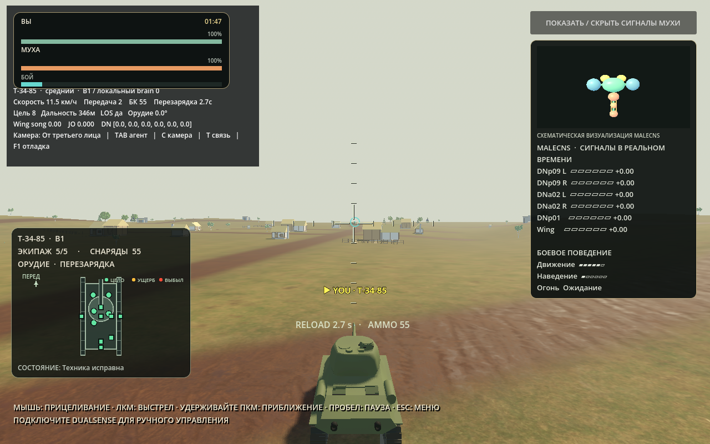
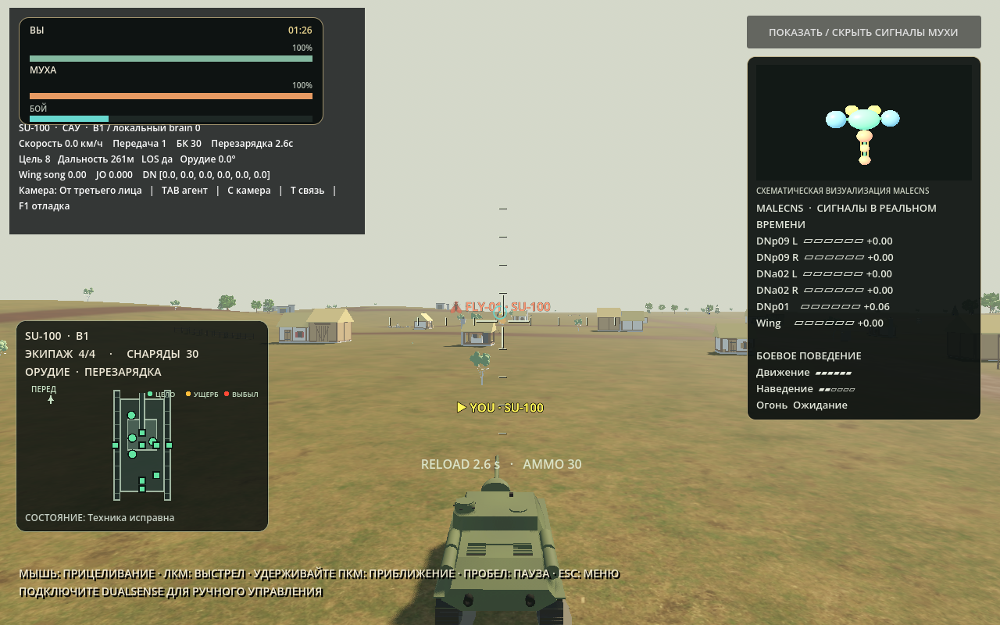
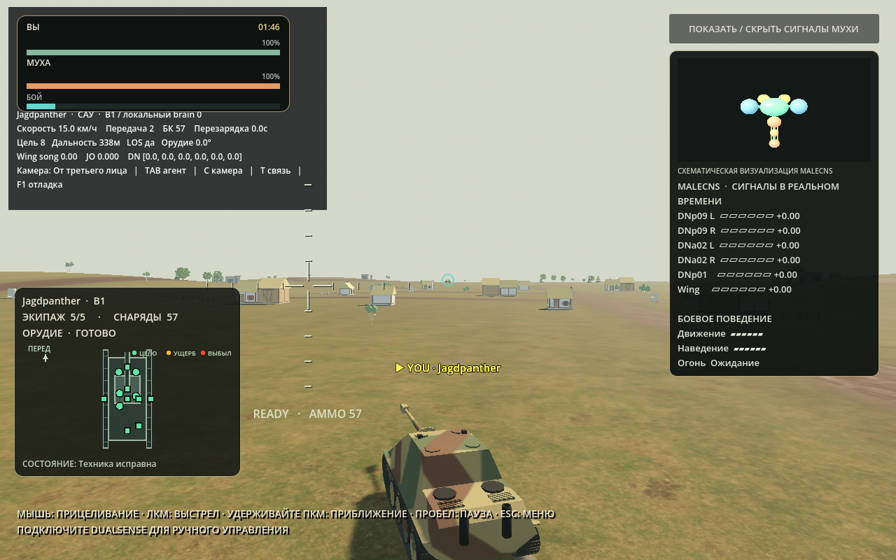

Максимумы времени кадра 303–428 мс в полных тестах включают начальный построитель
графа и первый показ сцены: тест пропускает заставку. Поэтому «стабильные 60 FPS без
единого выброса» не заявляются. Дополнительный 20-секундный живой профиль после
прогрева, при рендере 1280×800: **59,75 FPS**, средний кадр **16,70 мс**,
p99 **22,22 мс**, максимум **109,43 мс**, симуляция **1,001×** реального времени.
На двух кадрах выстрела максимум 45,33 мс, на двух кадрах попадания — 29,20 мс;
эта малая выборка не доказывает отсутствие всех задержек эффектов.
[Полный живой профиль](open-day-beta5-live-profile.json).

## Автотесты и сборка

- Python: **74 passed**, 4 subtests, два предупреждения PettingZoo о старом API.
- Геометрия, физические маршруты, тактика, стрельба шести моделей, камера и UI: 0 ошибок.
- Системы здоровья, выстрелы, пробития, завеса, завершение/повтор и программный ввод
  DualSense проходят существующую регрессию.
- [Проверки камеры и шести орудий](open-day-beta5-motion.json): максимальная лишняя
  относительная подвижка камеры менее 0,000001 м в свободном секторе.
- [GitHub Actions 40547008643](https://github.com/seruyvodoley/flyswarm-connectome/actions/runs/40547008643):
  success; сборка macOS arm64 с `a5c2820`. В CI проверены Python/Godot,
  60-секундный реальный MaleCNS, подпись, контрольные суммы и приложение,
  скопированное из DMG за пределы исходников. В упакованном приложении повторены
  шестимодельная огневая проверка и физическая проверка карты.
- [Публикация готового артефакта](https://github.com/seruyvodoley/flyswarm-connectome/actions/runs/40549762920)
  также завершилась успешно: сборка не переделывалась, её исходный SHA сохранён.
- Скачан публичный DMG; SHA-256 совпал. Копия из DMG проверена в отдельном
  каталоге `/Applications` при рабочем каталоге `/tmp`, без доступа к исходникам:
  подпись, arm64, контрольные суммы обоих файлов мозга, backend `--check-data`,
  запуск frontend, шестимодельная стрельба и физическая проверка карты — проходят.
- В этой копии выполнен полный нативный матч с данными **из её собственного
  `Contents/Resources/MaleCNS`**: 2816 ответов, 166 700 нейронов, без разрывов.
- Затем установлена `/Applications/FlySwarm.app`, версия **1.0.0-beta.5**.
  Повторены проверка подписи и запуск из установленного пути. Ещё один полный
  матч уже **из `/Applications/FlySwarm.app`**: 51,8 с, 2479 реальных ответов,
  0 ошибок, 0 застреваний, **59,12 FPS**, средний кадр 16,91 мс, p99 21,07 мс.
  После проверки открыто обычное меню Open Day.
- Первый нативный запуск копии DMG дал единичный межкадровый интервал **12,04 с**
  и среднее 47,81 FPS за весь замер. При повторном запуске установленной копии
  длинный интервал не повторился: максимум 302,94 мс, включая начальную подготовку.
  Причина первого интервала не изолирована; считать отсутствие задержки при любом
  холодном запуске доказанным нельзя. Прогретый режим и холодный запуск не смешиваются.
- [Полный протокол установки и обоих матчей](open-day-beta5-installation.json).

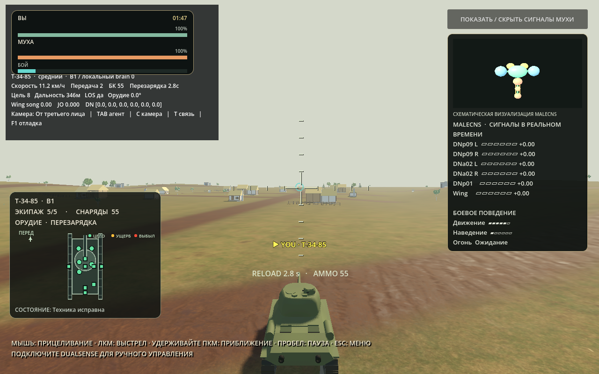

**Эталонная полная версия — [Beta 5](https://github.com/seruyvodoley/flyswarm-connectome/releases/tag/v1.0.0-beta.5).**
Код приложения совпадает с `main`; последующие коммиты добавляют только отчёты,
скриншоты и внешние проверочные инструменты. Исходный SHA проверенной сборки — `a5c2820`.

| Файл релиза | Размер, байт | SHA-256 |
|---|---:|---|
| DMG arm64 | 475735238 | `34b45b5400c863cd1e3f61f60dd1e907703dc568079aa81ed2c3572f1e68cfd2` |
| ZIP arm64 | 444944241 | `6eae6f3631899c15a2d17b003970a33683de5c1d33366be7993c7b182fb227c1` |

DMG проверен на Mac; ZIP и оба файла пакетов проверены в GitHub Actions.
Устаревшие полный релиз Beta 4 и его тег удалены; прежнее установленное приложение
отправлено в Корзину. Старый открытый DMG Beta 3 отключён и отправлен в Корзину;
устаревшие локальные артефакты Beta 4 удалены. Приложение Student, его ветка
`c961385`, релизы macOS/Windows Beta 3 и данные исследований не изменялись.
Локальная ссылка `origin/main` и её отслеживание исправлены: прежняя конфигурация
fetch содержала только устаревший тег. Рабочее дерево одно.
RisingSail по-прежнему не подключён; перенос репозитория на SSD заблокирован
отсутствием подключённого SSD. Рабочая папка: `/Users/serg/Desktop/FlySwarm-error-fix`.

## Ограничения и воспроизведение

Обученная PPO-политика на новой карте отдельно не проверена; её выбор в UI сохранён.
Физический DualSense вручную не проверен: его ввод и камера проверены
программными сценариями. Пять матчей с программным вводом мыши не оценивают
баланс против человека. На статичном ракурсе подъёма заметно ограничение существующей
упрощённой подвески: гусеницы не повторяют поверхность точно. Геометрия танков
по указанию владельца не менялась; это не отказ проходимости в проверенных заездах. Граф сохраняет консервативно закрытыми клетки разрушенных
зданий до перезапуска, хотя физические проходы открываются. Headless-диагностика
может сообщать прежние предупреждения Dummy renderer; native shutdown — предупреждения
particle shaders. Они перечислены отдельно от результатов проверок.

```sh
export OMP_NUM_THREADS=2 OPENBLAS_NUM_THREADS=2
Godot --headless --fixed-fps 120 --path frontend/godot --script res://scripts/app/open_day_map_validation.gd
Godot --headless --fixed-fps 120 --path frontend/godot --script res://scripts/app/open_day_motion_validation.gd
FLY_DATA=/path/to/MaleCNS Godot --path frontend/godot --script res://scripts/app/open_day_five_match_validation.gd -- --matches=5 --output=/path/to/report.json
Godot --path frontend/godot --script res://scripts/app/open_day_map_gallery.gd
Godot --headless --fixed-fps 120 --path frontend/godot --script /absolute/path/tools/validate_open_day_buildings.gd
python tools/validate_open_day_routes.py /path/to/Godot
python tools/prepare_open_day_benchmark_baseline.py
Godot --path frontend/godot --script res://scripts/app/open_day_render_benchmark.gd -- --baseline-script=/absolute/path/build/validation/beta4-fixtures/battle.gd
Godot --path frontend/godot --script res://scripts/app/open_day_render_benchmark.gd
```

DMG содержит `brain.npz`, `weights.npz`, автономный backend, модели и лицензии.
Приложение подписано ad-hoc, notarization отсутствует. Student Edition не изменяется.
